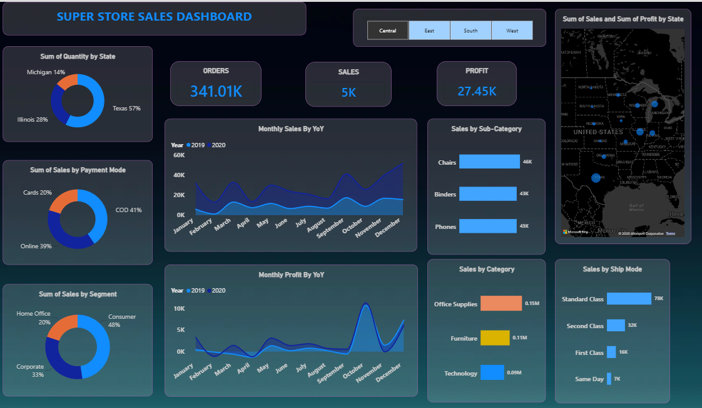

# Super Store Sales Dashboard | Power BI

## Dashboard Preview

## Project Overview
An interactive sales analytics dashboard built using Microsoft Power BI to analyze sales, profit, orders, and customer purchasing patterns.

## Tools & Technologies
- Microsoft Power BI
- Power Query for data cleaning and transformation
- DAX for measures and calculations
- Data visualization and business intelligence

## Dashboard Features
- KPI cards for Orders, Sales, and Profit
- Sales analysis by category and sub-category
- Monthly sales and profit trends across years
- Sales analysis by payment mode and customer segment
- Sales by shipping mode
- Geographic analysis using a map visual
- Interactive regional filters

## Key Business Questions
- Which product categories generate the highest sales?
- Which shipping mode is most frequently used?
- How do sales and profits change over time?
- Which customer segments contribute most to sales?
- How do sales vary across geographic regions?

## Project Files
- `Super_Store_Sales_Dashboard.pbix` — Power BI report
- `Screenshots/` — Dashboard preview images
- `Dataset/` — Source data, if permitted to share

## Author
Rehan Tamboli

